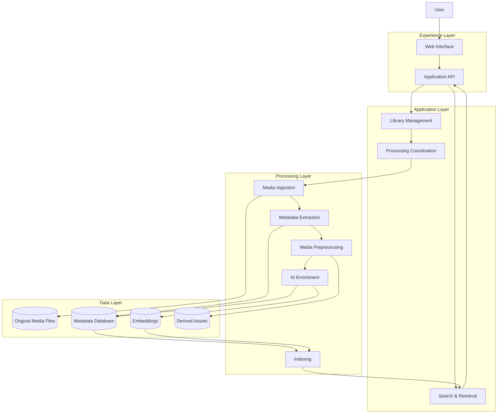

# AetherVision — Architecture Overview

**Document status:** Living document  
**Architecture classification:** Local-first modular application, evolving toward distributed multimodal processing  
**Last reviewed:** 2026-11-19

## 1. Introduction

AetherVision is a local-first multimodal intelligence platform designed to transform personal media collections into searchable, contextual and interconnected knowledge.

The platform combines media ingestion, metadata extraction, computer vision, local AI inference and semantic retrieval to enable intelligent exploration of heterogeneous personal media.

AetherVision is designed around three fundamental objectives:

- **Privacy and data ownership:** Personal media and associated knowledge remain under user-controlled infrastructure.
- **Multimodal intelligence:** Media is enriched through metadata extraction, machine learning and semantic representations.
- **Extensible processing:** Processing capabilities should evolve independently of the user-facing application and support different execution environments.

This document describes the architectural principles, logical structure, current implementation and intended architectural evolution of AetherVision.

## 2. Architectural Vision

AetherVision aims to establish a unified intelligence layer over personal media collections.

Rather than treating images and videos as isolated files, the platform progressively enriches media with structured metadata, semantic descriptions, visual embeddings and contextual relationships.

The resulting system enables:

- Unified media discovery.
- Semantic and full-text retrieval.
- AI-assisted media understanding.
- Contextual exploration of personal collections.
- Incremental enrichment as models and processing capabilities evolve.

The long-term vision is to support distributed processing while preserving a local-first data ownership model.

## 3. Architectural Principles

### 3.1 Local-First

The system prioritizes local execution and user-controlled storage.

Original media should remain accessible independently of AetherVision. The application manages references, metadata and derived representations rather than requiring ownership of the original media files.

### 3.2 Privacy by Design

Personal media may contain sensitive information, including faces, location data and private documents.

Processing should therefore prefer local execution and minimize unnecessary data transmission.

External services, where supported, should be explicit, optional and configurable.

### 3.3 Incremental Processing

Media libraries can contain thousands or millions of files.

The system should avoid unnecessary full-library processing by tracking media identity, processing state and changes over time.

### 3.4 Resource-Aware Execution

AI workloads can be computationally expensive.

The architecture should account for available CPU, GPU, memory and storage resources when executing inference workloads.

### 3.5 Modular Architecture

Responsibilities should be separated into clear logical domains.

The initial implementation may remain a modular Python application. Architectural boundaries should not require immediate deployment as independent services.

### 3.6 Reproducibility

Derived artifacts should be traceable to their source media, processing configuration and model version.

Where practical, derived data should be regenerable without modifying original media.

## 4. Architectural Style

### 4.1 Current Architecture

The current implementation is best characterized as a local-first modular monolith.

Its principal technologies include:

| Layer | Technology / Approach |
|---|---|
| Application | Python |
| Web framework | Flask |
| Persistence | SQLite |
| Database concurrency | SQLite WAL and application-level connection management |
| Background execution | Python threading and thread pools |
| Media processing | Python image-processing libraries |
| AI processing | Locally executed AI models |
| Search | SQLite FTS5 and embedding-related infrastructure |
| Media storage | User-managed filesystem |

The application combines HTTP handling, indexing, metadata extraction, processing and persistence within a shared application runtime.

### 4.2 Target Architecture

The target architecture introduces more explicit processing boundaries:

- Media ingestion and change detection.
- Metadata extraction and normalization.
- Processing orchestration.
- Model execution and inference workers.
- Search and retrieval.
- Persistent metadata and derived artifact storage.

These boundaries are logical architectural responsibilities. They do not necessarily imply separate processes or microservices.

## 5. High-Level Architecture

The following diagram represents the logical target architecture.

**Diagram classification:** Logical target architecture. It describes intended responsibilities, not the exact runtime deployment of the current implementation.

## 6. Core Architectural Domains

| Domain | Responsibility |
|---|---|
| Media ingestion | Discover media and identify filesystem changes |
| Media identity | Establish stable media identity and detect duplicates |
| Metadata management | Extract, normalize and persist metadata |
| Preprocessing | Generate thumbnails and normalized representations |
| AI enrichment | Execute vision, OCR, captioning and embedding workloads |
| Processing coordination | Track processing state and coordinate workloads |
| Search and retrieval | Support full-text and semantic discovery |
| Persistence | Store metadata, processing state and derived information |
| User experience | Expose media exploration and search capabilities |

## 7. Data Ownership and Source of Truth

AetherVision distinguishes between original media and application-generated information.

| Data category | Ownership / responsibility |
|---|---|
| Original media | User-managed filesystem |
| Media references | Application |
| Extracted metadata | Application database |
| Processing state | Application database |
| Thumbnails | Derived artifacts |
| Captions and tags | Derived metadata |
| Embeddings | Derived semantic representations |
| Search indexes | Rebuildable retrieval infrastructure |

The original media should remain the authoritative source for media content.

Derived artifacts should be treated as reproducible data wherever practical.

## 8. Quality Attributes

The architecture should be evaluated against the following quality attributes.

| Attribute | Architectural objective |
|---|---|
| Privacy | Local processing and controlled data exposure |
| Reliability | Recoverable processing and consistent metadata |
| Scalability | Support growing media collections |
| Performance | Incremental indexing and efficient retrieval |
| Extensibility | Pluggable processing and inference capabilities |
| Portability | Support different local execution environments |
| Maintainability | Clear module boundaries and documented contracts |
| Observability | Traceable processing state and actionable diagnostics |

## 9. Architectural Evolution

AetherVision should evolve incrementally.

### Stage 1 — Local Application

- Single application runtime.
- SQLite persistence.
- Filesystem-based media indexing.
- In-process parallel processing.
- Local AI inference.

### Stage 2 — Modular Processing

- Explicit processing interfaces.
- Durable processing state.
- Standardized inference contracts.
- Resource-aware workload management.
- Improved observability and recovery.

### Stage 3 — Distributed Execution

- Independently managed processing workers.
- Worker capability registration.
- Workload scheduling.
- Resource-aware task assignment.
- Controlled communication between components.

### Stage 4 — Distributed Multimodal Intelligence

- Multiple processing nodes.
- Heterogeneous CPU/GPU execution.
- Distributed inference workloads.
- Coordinated indexing and retrieval.
- Resilient processing across execution environments.

These stages represent an architectural direction, not a commitment that all capabilities are currently implemented.

## 10. Architecture Documentation

| Document | Description |
|---|---|
| System Context | External actors, dependencies and boundaries |
| Container Architecture | Logical application and processing components |
| Component Design | Internal responsibilities and interfaces |
| Data Architecture | Data ownership, lifecycle and persistence |
| Inference Pipeline | AI workload execution and enrichment |
| Distributed Execution | Future worker-based processing architecture |
| Deployment Topology | Deployment models and runtime environments |
| Security and Privacy | Trust boundaries and security controls |

## 11. Architectural Governance

Architectural changes should be documented using Architecture Decision Records (ADRs).

ADRs should explain:

- The problem or architectural context.
- Considered alternatives.
- The selected approach.
- Consequences and trade-offs.
- The implementation status.

See **Architecture Decision Records** for individual decisions.

---

**Guiding principle:** AetherVision should grow from a reliable local-first media intelligence application into a distributed multimodal platform without compromising data ownership, privacy or architectural simplicity.
