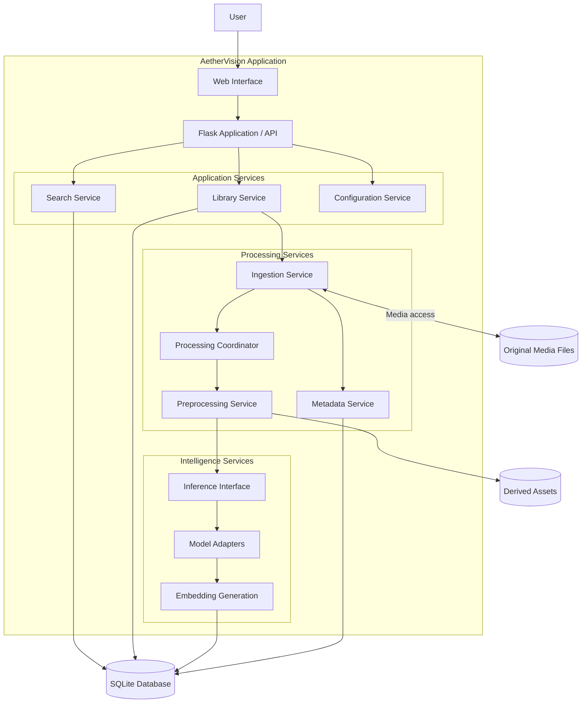
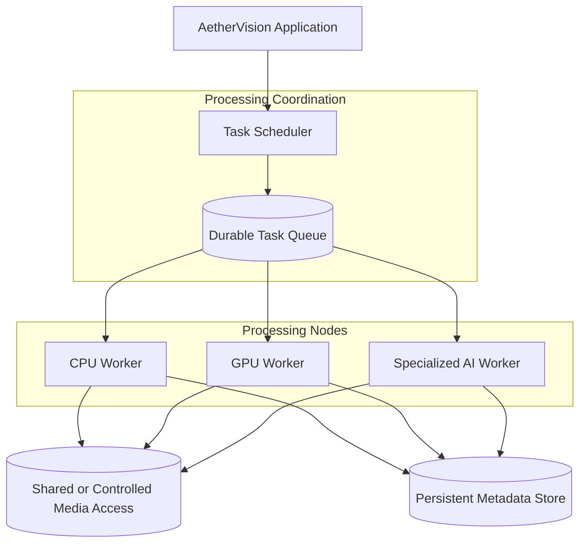

# AetherVision — Container Architecture

## 1. Purpose

This document describes the major logical and runtime building blocks of AetherVision, their responsibilities and their interactions.

It distinguishes the current implementation from the intended architectural structure.

In the C4 model, a container represents an independently deployable application or data store. It does not necessarily mean a Docker container.

## 2. Current Runtime Architecture

The current implementation primarily operates as a Python application using Flask, SQLite and in-process background execution.

Its responsibilities include:

- HTTP request handling.
- Media library management.
- Filesystem indexing.
- Metadata extraction.
- Thumbnail generation.
- AI-related processing.
- Search and database persistence.

The current architecture does not require a distributed message broker or independently deployed inference workers.

## 3. Logical Container Model

The following diagram illustrates the proposed logical decomposition.

**Classification:** Logical target architecture. Some boxes represent responsibilities currently implemented within the same Python process and should not be interpreted as separate deployed services.

## 4. Container Responsibilities

### 4.1 Web Interface

**Responsibility:** User interaction and media exploration.

Primary functions:

- Display indexed media.
- Browse collections.
- Submit search queries.
- Display metadata and AI-generated information.
- Expose media management controls.

The web interface should not implement indexing or inference business logic directly.

### 4.2 Application API

**Responsibility:** Application entry point and request orchestration.

Primary functions:

- Handle HTTP requests.
- Validate incoming parameters.
- Invoke application services.
- Manage responses and errors.
- Enforce applicable access controls.

**Current implementation:** Flask application.

### 4.3 Library Service

**Responsibility:** Media library management.

Primary functions:

- Manage configured media locations.
- Expose media records.
- Coordinate indexing operations.
- Track library-level information.
- Provide access to media metadata.

### 4.4 Ingestion Service

**Responsibility:** Discover and register media.

Primary functions:

- Scan configured directories.
- Identify supported media.
- Calculate content hashes.
- Detect new and changed files.
- Identify duplicate content.
- Maintain media references.

The ingestion service should avoid coupling filesystem discovery to AI inference execution.

### 4.5 Metadata Service

**Responsibility:** Extract and normalize media metadata.

Primary functions:

- EXIF extraction.
- Image dimensions and format information.
- GPS metadata.
- Capture timestamps.
- Normalized metadata persistence.

Metadata extraction should be independently executable where practical.

### 4.6 Preprocessing Service

**Responsibility:** Prepare media for subsequent processing.

Primary functions:

- Thumbnail generation.
- Image normalization.
- Resolution handling.
- Format conversion where required.
- Preparation of inference inputs.

Preprocessing should preserve original media.

### 4.7 Processing Coordinator

**Responsibility:** Coordinate processing workflows.

Target responsibilities:

- Determine required processing tasks.
- Track task status.
- Schedule eligible workloads.
- Handle failures and retries.
- Coordinate processing dependencies.
- Prevent unnecessary duplicate execution.

In the current implementation, processing coordination may be handled through in-process application logic.

### 4.8 Inference Interface

**Responsibility:** Provide a standardized interface to AI capabilities.

Potential capabilities:

- Image classification.
- Image captioning.
- Object recognition.
- OCR.
- Visual embeddings.
- Semantic enrichment.

The application should depend on inference interfaces rather than individual model implementations.

### 4.9 Model Adapters

**Responsibility:** Encapsulate model-specific execution details.

Each adapter should define:

- Model identity.
- Input requirements.
- Output schema.
- Model version.
- Resource requirements.
- Initialization and cleanup behavior.
- Execution errors.

This allows different models to be integrated without modifying core application logic.

### 4.10 Persistence Layer

**Responsibility:** Persist application state and derived information.

The current persistence implementation uses SQLite.

Logical data domains include:

- Media records.
- Library configuration.
- Extracted metadata.
- AI enrichment results.
- Processing state.
- Search indexes.
- Embedding references.

## 5. Communication Patterns

The architecture should distinguish between synchronous and asynchronous interactions.

| Interaction | Preferred pattern |
|---|---|
| User requests media | Synchronous |
| User submits search | Synchronous |
| Media discovery | Background processing |
| Metadata extraction | Processing task |
| Thumbnail generation | Processing task |
| AI inference | Background processing |
| Embedding generation | Background processing |
| Search index updates | Processing task |

Long-running inference workloads should not block normal user-facing HTTP requests.

## 6. Architectural Contracts

Logical components should communicate through explicit contracts.

### 6.1 Media Record

A media record should identify:

- Stable media identifier.
- Source location.
- Media type.
- Content hash.
- File size.
- Modification information.
- Ingestion status.

### 6.2 Processing Task

A processing task should identify:

- Task identifier.
- Associated media identifier.
- Processing type.
- Model identifier, if applicable.
- Input version.
- Execution status.
- Creation and completion timestamps.
- Failure information.

### 6.3 Inference Result

An inference result should identify:

- Media identifier.
- Model identifier.
- Model version.
- Processing type.
- Structured result.
- Processing timestamp.
- Relevant execution metadata.

These are logical contract requirements, not assertions about existing database schemas.

## 7. Architectural Constraints

The following constraints should guide implementation decisions:

- Application services should not directly depend on specific model implementations.
- Original media should remain separate from derived artifacts.
- Processing operations should be designed for safe repetition.
- Database access should be centralized through defined persistence interfaces.
- Long-running operations should execute outside synchronous request handling.
- Processing state should survive application restarts as the architecture evolves.
- Components should expose clear failure and completion states.
- New processing capabilities should not require changes to unrelated application domains.

## 8. Evolution Toward Distributed Processing

The logical architecture should support an incremental transition toward independently managed processing workers.

A future deployment could introduce:

This is a target architecture, not the current deployment.

Before introducing distributed workers, the system should establish:

- Durable task state.
- Explicit task contracts.
- Idempotent processing.
- Worker registration and capabilities.
- Controlled media access.
- Failure recovery.
- Resource-aware scheduling.
- Result validation and persistence.

