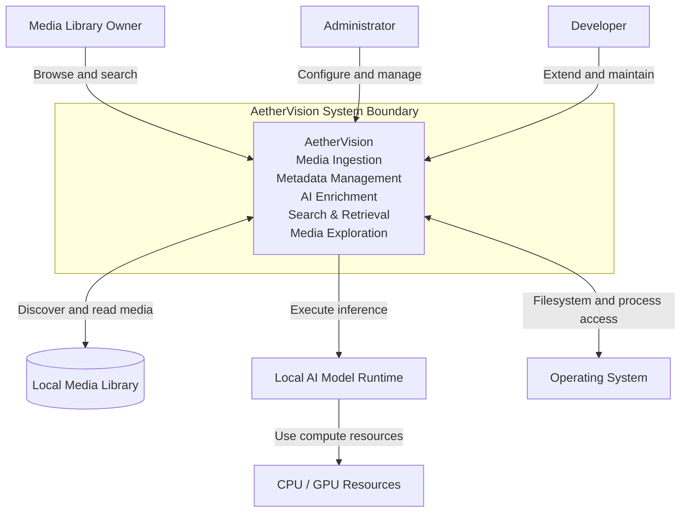

# AetherVision — System Context

**Document status:** Living document  
**Architecture level:** C4 — Level 1 (System Context)

## 1. Purpose

This document describes AetherVision from an external perspective.

It identifies the primary users, external systems, data sources and interactions with the platform.

The purpose is to establish a clear system boundary and clarify which responsibilities belong to AetherVision versus external infrastructure.

## 2. System Boundary

AetherVision is responsible for:

- Media discovery and ingestion.
- Media identification.
- Metadata extraction and management.
- Media preprocessing.
- AI-based enrichment.
- Search and retrieval.
- Processing lifecycle management.
- User-facing media exploration.

The platform does not inherently own the original media files or require an external cloud service for its core local-first functionality.

## 3. Primary Actors

| Actor | Description | Interaction |
|---|---|---|
| Media Library Owner | Person managing a personal media collection | Configures libraries, browses and searches media |
| Administrator | Person responsible for installation and operation | Configures storage, resources and application settings |
| Developer | Contributor extending the platform | Implements processing capabilities and integrations |
| Processing Worker | Future execution component | Executes assigned processing tasks |

## 4. External Systems and Dependencies

| External system | Purpose | Relationship |
|---|---|---|
| Local filesystem | Stores original media | Primary media source |
| AI model runtimes | Execute inference | Processing dependency |
| CPU / GPU hardware | Provides compute resources | Execution infrastructure |
| Operating system | Provides filesystem and process services | Runtime dependency |
| Optional external integrations | Potential future data or processing sources | Explicitly controlled integration |

External services should not be assumed to be mandatory components of the platform.

## 5. System Context Diagram

## 6. Primary Interaction Flows

### 6.1 Initial Media Discovery

1. The administrator configures one or more media locations.
2. AetherVision discovers supported files.
3. Media identity is established.
4. Metadata is extracted.
5. Processing requirements are determined.
6. Derived artifacts and searchable metadata are generated.

### 6.2 Incremental Media Updates

1. A configured media location changes.
2. The indexing process detects the change.
3. The application determines whether media is new, modified, moved or missing.
4. Relevant metadata and derived artifacts are updated.
5. Search indexes are synchronized.

The exact detection mechanism depends on the indexing implementation.

### 6.3 Search and Retrieval

1. A user submits a search query.
2. AetherVision interprets the query.
3. The retrieval layer searches available metadata and indexes.
4. Matching media references are returned.
5. The user explores the results.

### 6.4 AI Enrichment

1. Media is identified as requiring enrichment.
2. Applicable processing tasks are determined.
3. Suitable local models are selected.
4. Inference is executed.
5. Results are normalized and persisted.
6. Search indexes are updated.

## 7. Trust Boundaries

AetherVision handles potentially sensitive personal information.

The following trust boundaries should be considered:

| Boundary | Security consideration |
|---|---|
| User to application | Authentication, authorization and request validation |
| Application to filesystem | Restrict access to configured media locations |
| Application to model runtime | Control model loading and execution |
| Application to network | Minimize unnecessary exposure |
| Application to external integrations | Explicit configuration and data disclosure |
| Processing worker to storage | Controlled access and validated task execution |

## 8. Privacy Considerations

Personal media can contain sensitive information, including:

- GPS coordinates.
- Faces and biometric-like visual information.
- Private documents and screenshots.
- Personal events and relationships.
- Device and capture metadata.

The architecture should ensure that:

- Original media is not modified during ordinary indexing.
- Processing remains local by default where supported.
- Network exposure is minimized.
- Sensitive metadata is handled deliberately.
- External processing integrations are explicit.
- Users retain control over configured media sources.

## 9. Assumptions and Constraints

The following architectural assumptions guide the design:

- Users control the media locations configured in the application.
- Original media can remain outside the application database.
- AI inference may require substantial memory and compute resources.
- Media formats and metadata quality vary.
- Processing can be interrupted and must support recovery.
- Some inference capabilities may be optional or unavailable in constrained environments.

